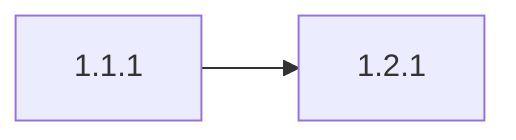

# Graph arrows

## Wave 1

### Phase 1.1 Alpha

**Tasks**
- **1.1.1** `[tier:medium]` Alpha work in `src/alpha/core.ts`.
  Writes: `src/alpha/core.ts`

### Phase 1.2 Beta

**Tasks**
- **1.2.1** `[tier:medium]` Beta work in `src/beta/util.ts`.
  Writes: `src/beta/util.ts`

### Phase 1.3 Gamma

**Tasks**
- **1.3.1** `[tier:medium]` Gamma work in `src/alpha/format.ts`.
  Writes: `src/alpha/format.ts`

### Phase 1.4 Delta

**Tasks**
- **1.4.1** `[tier:medium]` Delta work in `src/alpha/helpers.ts`.
  Writes: `src/alpha/helpers.ts`

```text
1.1 -> 1.2
1.2 → 1.3
1.3 --> 1.4
```


